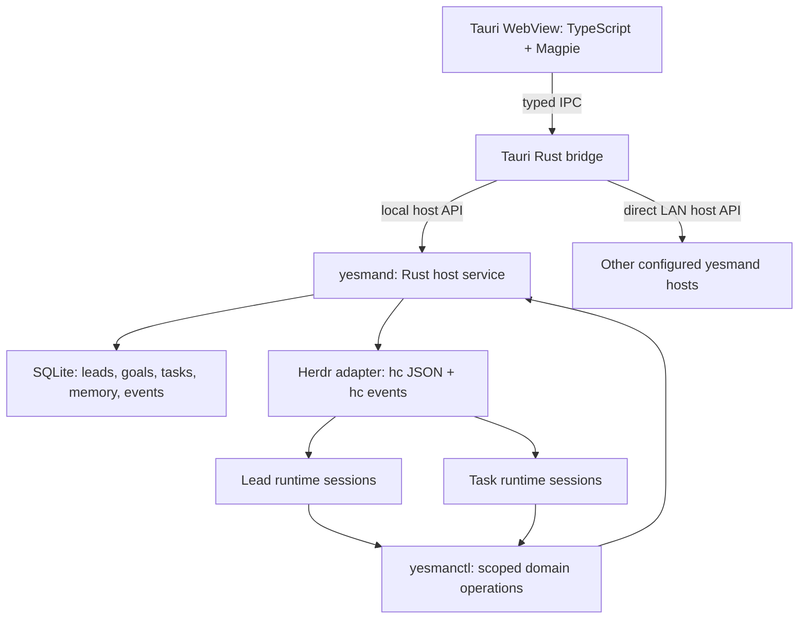

# Architecture

This document defines the proposed implementation of yesman. The repository currently contains design documentation only. The [design notes](design-notes.md) preserve the reasoning from the initial discussion, and the [frontend contract](frontend.md) specifies Magpie integration.

## Scope and selected stack

The first version covers permanent leads, goal discussion, task delegation, human triage, local delivery tracking, and a desktop view of local and explicitly configured LAN hosts.

| Layer | Decision |
| --- | --- |
| Desktop | Tauri 2 with a bundled TypeScript/HTML frontend |
| Design system | `idy/magpie-design-system`, packaged locally at a pinned revision |
| Application backend | Rust host service plus a small Tauri Rust bridge |
| Persistence | Host-owned SQLite database; per-lead memory namespaces |
| Agent runtime | herdr-core through the documented `hc` CLI and event stream |
| Agent choice | Configured lead and task runtimes, including Codex, Claude Code TUI, and pi |
| Connectivity | Explicit reachable host URLs on a LAN or an already configured external network |

Hierarchical cascading, parent leads supervising other leads, recursive host discovery, and automated host-to-host delegation are outside the first version. Herdr's local lead-to-worker parent-child relationship is still required.

## Process boundaries

The names `yesmand` and `yesmanctl` describe proposed binaries, not implemented commands.

- **Tauri frontend:** display boards and conversations, collect user intent, and render connection state.
- **Tauri Rust bridge:** connect to local and configured hosts, hold client credentials, and forward typed commands and events.
- **Rust host service:** enforce domain rules, persist host-owned records, coordinate leads and workers, and expose one host API.
- **Herdr:** run terminal agents, deliver input, expose output and runtime status, and report runtime events.
- **Agent-facing CLI:** let leads and workers submit structured domain operations to their own host service.

The host service runs independently of the desktop window. A headless host needs the service, Herdr, and its configured agents, but no WebView. Closing the UI does not intentionally stop the service or cancel work. Service startup and packaging must implement this explicitly; a generic Tauri child or sidecar is not assumed to survive application exit.

## Domain model and ownership

| Entity | Durable responsibility |
| --- | --- |
| Host | Identity, local repositories, runtime availability, and host API endpoint |
| Lead | Permanent slot, conversation, memory namespace, repository scope, and task board |
| Goal | Requested outcome, agreed scope, decisions, and acceptance criteria |
| Repository | Registered local checkout and local integration queue |
| Task | One bounded deliverable, dependencies, owning lead/host, state, and delivery requirements |
| Execution attempt | Chosen runtime, launch intent, Herdr terminal reference, status, and result for a task |
| Finding | Discovery, source task, impact, duplicate links, and disposition |
| Decision | User's triage or scope decision and the records it changes |
| Delivery evidence | Commit, PR, verification, merge, or release record supporting acceptance |

One host can contain many leads; one lead can manage many repositories, goals, and concurrent tasks. A task can touch multiple repositories on its owning host. Multiple sequential attempts retain the same task identity.

Each task has exactly one owning lead and host. Entity IDs remain stable across reconnects. Aggregate views identify records by their source host and entity ID; they do not create duplicate authoritative tasks.

A goal or task is distinct from a runtime session. A lead is also distinct from its current runtime session. No lead-parent hierarchy is required in the first-version model.

## Permanent lead slots

A slot stores the lead ID, name, owning host, operating instructions, repository scope, conversation, memory, tasks, runtime configuration, and current runtime reference.

Leads are permanent. Task completion, cancellation, session exit, and application closure never delete a lead. Pause, resume, restart, and runtime replacement preserve the same slot.

Only one lead session may issue scheduling decisions for a slot at a time. Multiple desktop clients can view the slot without creating additional lead runtimes. A lead can coordinate many tasks concurrently; it does not need a separate identity for each goal.

A paused or failed runtime does not erase the lead's identity. On recovery, the service loads durable records, reconciles workers, and restores the lead through the selected runtime's supported continuation mechanism or a new session with reconstructed context.

## Persistence and independent memory

Use one host-owned SQLite database for authoritative leads, goals, tasks, attempts, findings, decisions, memory entries, command receipts, delivery evidence, and host events.

Memory is namespaced by lead ID. Each lead can maintain its own preferences, relationships, decisions, and reusable lessons through scoped memory operations. There is no implicit cross-lead memory sharing.

A per-lead `memory.md` can be generated as an export or prompt input. It is derived from authoritative memory records rather than a second independently writable source of truth. Provider-specific session histories may help continuation, but are not the canonical lead memory.

Task status, dependencies, active executions, and delivery requirements are structured records. The service must not reconstruct them solely from an LLM summary or terminal transcript.

Commit a domain mutation and its event in the same SQLite transaction. Maintain command IDs and entity revisions so retries can return an existing result and conflicting updates can be rejected without creating duplicate work.

## Discuss, decompose, dispatch, deliver

1. The user discusses a goal with the selected lead and agrees its scope and acceptance criteria.
2. The lead creates bounded tasks, dependencies, repository assignments, and delivery requirements.
3. Accepted work within that scope can proceed without per-subtask confirmation.
4. The service records a launch intent before starting a worker through Herdr.
5. Worker updates and findings are associated with their task and attempt.
6. The lead follows dependencies and delivery evidence until the agreed outcome is satisfied.
7. New decisions enter **to triage** for the user.

The lead coordinates; task sessions perform implementation, testing, commits, merges, and release work. Different tasks may select different configured agents without changing the domain model.

## Herdr integration

Use a small Rust adapter around the documented `hc` interface. Prefer explicit JSON output for machine-readable operations. Do not couple the first implementation to private Herdr crates or undocumented desktop-app state.

| Need | Documented Herdr surface |
| --- | --- |
| Start a lead or worker | `hc run`, background mode, templates, working directory, names, and labels |
| Inspect and reconcile | `hc ls`, `hc get`, and `hc server status` |
| Send an agent input | `hc send` |
| Read output and wait | `hc read`, `hc wait` |
| Receive runtime changes | `hc events`, with JSON-line output when piped |
| Inspect a future native protocol | `hc schema` and `hc connect`; not required for the initial adapter |

The exact executable version, schemas, supported runtimes, and flags must be validated during implementation. The command names above are upstream capabilities, not an implemented yesman adapter.

The service launches outside the lead's terminal, so it must explicitly associate a worker with the correct lead using Herdr's `--parent` option. Do not rely on the caller automatically being the intended lead. Lead roots use no worker parent. Persist the actual returned terminal reference; an active-terminal name is not a permanent slot ID.

Use application labels to associate a launch with its lead, task, and attempt. If a launch response is lost, reconcile those labels before retrying. An uncertain launch must not immediately produce a second worker for the same active attempt.

Use the documented `--outlive-parent` behavior for workers that must survive lead-session replacement. Task cancellation is a separate, explicit service action. Herdr's default child lifetime must not accidentally turn a lead restart into cancellation of all its tasks.

Treat Herdr events as runtime observations. The documented stream does not establish durable replay, so reconnect by inspecting active and relevant finished terminals and reconciling them with persisted attempts. yesman's own host event stream is separate.

Even though Herdr supports remote machines, the first version runs `hc` locally on each owning host. A desktop client's remote request goes to that host's yesman service; it does not use a local `hc --on` path to bypass the remote lead and task records.

## Agent-facing domain operations

Provide a small Rust CLI with structured JSON input/output for operations such as task creation, finding reports, memory updates, progress updates, and delivery-evidence submission. All supported coding agents can invoke it through their normal tool environment; no new model-provider integration is required.

The service issues session-scoped identity and permissions at launch. A caller-supplied lead or task ID is not sufficient to assume that identity.

- A lead can manage its own goal and task records and request execution.
- A worker can report against its own task and attempt.
- Neither can resolve human triage as the user.
- The user can record triage decisions through the desktop application.

An MCP facade can be added later if useful; it is not necessary for the first integration contract.

## Findings and human triage

A discovery is not automatically an instruction to expand the current task. The lead associates it with existing work, identifies duplicates, and determines whether it blocks the deliverable.

Non-blocking findings can be reported while the worker finishes. Blocking findings create a visible blocker or dependency. Work already covered by the agreed goal can become a ready task; a product choice, missing authorization, or unresolved scope question goes to **to triage**.

Every item in **to triage** waits for the user. The lead may investigate and recommend, but only a user decision releases it. Decisions made in conversation must be recorded as domain operations, not left only in chat history.

## Task state and delivery evidence

| State | Meaning |
| --- | --- |
| `to triage` | Waiting for the user's decision |
| `ready` | Accepted work that can run when dependencies permit |
| `running` | An active execution attempt is performing the task |
| `blocked` | A dependency, missing information, or execution issue prevents progress |
| `awaiting merge` | A required merge is outstanding |
| `awaiting release` | A required release is outstanding |
| `done` | Required acceptance and delivery evidence are satisfied |
| `cancelled` | Intentionally stopped; history remains |

Runtime state and task state are separate. Idle, done, blocked, or exited terminal observations do not by themselves prove that the task passed verification, merged, or shipped.

Acceptance criteria determine the required endpoint. A documentation task may require a commit or PR; a production change may require a verified release. Record concrete evidence and its source. The lead follows the process while execution sessions and repository delivery services perform the actions.

## Repository execution and integration

Use separate worktrees or equivalent isolated working directories for concurrent code tasks. Keep repository paths registered on their owning host.

A per-repository integration queue coordinates merge and release requests from local leads. Before merging, verify the relevant head and required checks against the repository service. Across independent hosts, use the repository's existing merge/CI facilities rather than introducing a distributed lock service in the first version.

## Host API and desktop aggregation

Use the same versioned host API for local and configured LAN hosts. The following endpoints are proposed yesman contracts, not existing Herdr endpoints:

| Endpoint | Purpose |
| --- | --- |
| `GET /v1/host` | Host identity, API version, and capabilities |
| `GET /v1/snapshot` | Consistent view of domain records and its event cursor |
| `GET /v1/events?after=<sequence>` | SSE stream of persisted host events after a cursor |
| `POST /v1/commands` | Typed domain command with command ID and revision preconditions |
| `GET /v1/commands/<id>` | Recover a command result after an uncertain response |

The Tauri Rust bridge connects directly to each configured host. It combines snapshots and host events for presentation. Each host remains authoritative for its own records. Reconnection uses the last host-local event cursor; an expired cursor requires a new snapshot.

Commands carry a unique command ID and resolve on the owning host. A timeout is not proof that a command failed, so the client retrieves its receipt before sending another logical command. A stale or disconnected board cannot optimistically reassign a task to another host.

A user can select a remote lead and submit a goal to its host. Automatic lead-to-lead or host-to-host delegation is deferred, as are cross-host dependency scheduling and recursive board forwarding.

## LAN and external networking

Configure host URLs explicitly; automatic discovery is not required. Listen locally by default and explicitly enable a LAN endpoint when wanted. Authenticate host connections and session-scoped agent operations. Keep host connection credentials in the Rust client/service boundary rather than exposing generic execution credentials to frontend code.

yesman does not implement a VPN, routing engine, NAT traversal, relay, or a custom overlay network. The named external connectivity project is [idy/tailsplit](https://github.com/idy/tailsplit). Existing network and tailsplit configuration can make a host URL reachable across networks; yesman still uses the ordinary host API.

Do not assume a Tailsplit application proxy or exit-node route automatically publishes a listening yesman service. Reachability is an external deployment prerequisite. Network connectivity also does not add application-level cascading: hierarchical delegation remains a separate deferred feature.

## Frontend and desktop boundary

Follow the [Magpie frontend contract](frontend.md). Package CSS, helpers, icons, fonts, and licenses locally; implement yesman-specific board and conversation components with Magpie tokens and primitives.

Use typed Tauri commands and explicit capabilities/custom-command access. Do not expose a generic shell runner or unrestricted `hc` bridge to the WebView. A peer provides data, not privileged remote HTML. Keep domain enforcement in the host service even when a request originated in the bundled desktop UI.

Start with native Tauri window decorations. Magpie's raw window-host helper is not a Tauri bridge and must not be enabled unchanged.

## Recovery expectations

- Restarting a WebView or desktop window preserves leads, memory, tasks, and active workers.
- Restarting the host service reconciles existing Herdr terminals before dispatching new work.
- A lead-session restart preserves its slot and does not implicitly cancel independent workers.
- An interrupted or unknown attempt remains visible until its execution and delivery state are reconciled.
- A disconnected peer displays last-known state as stale; its tasks retain their owning host.
- Network reachability never transfers a repository checkout or running task to a different machine.

## Implementation sequence

1. **Host foundation:** Rust domain types, SQLite persistence, permanent slots, command receipts, and host events.
2. **Local execution loop:** one lead, heterogeneous Herdr workers, scoped agent-facing CLI, findings, triage, and delivery evidence.
3. **Desktop workflow:** Tauri bridge and Magpie-based board, lead conversation, and task details.
4. **Flat LAN connections:** explicit host configuration, authentication, snapshots/events, stale-state handling, and a combined board.
5. **Delivery hardening:** concurrent repository coordination and verified merge/release progression.

The first useful milestone is a local discuss-delegate-deliver loop. Flat LAN aggregation is part of the intended first-version scope; hierarchical cascading is not. This documentation change does not implement any of those milestones.

## References

- [Herdr core](https://github.com/herdrdev/herdr-core)
- [Herdr command reference](https://github.com/herdrdev/herdr-core/blob/master/docs/commands.md)
- [Herdr templates](https://github.com/herdrdev/herdr-core/blob/master/docs/templates.md)
- [Magpie design system](https://github.com/idy/magpie-design-system)
- [Tauri process model](https://v2.tauri.app/concept/process-model/)
- [Tauri capabilities](https://v2.tauri.app/security/capabilities/)
- [tailsplit](https://github.com/idy/tailsplit)
